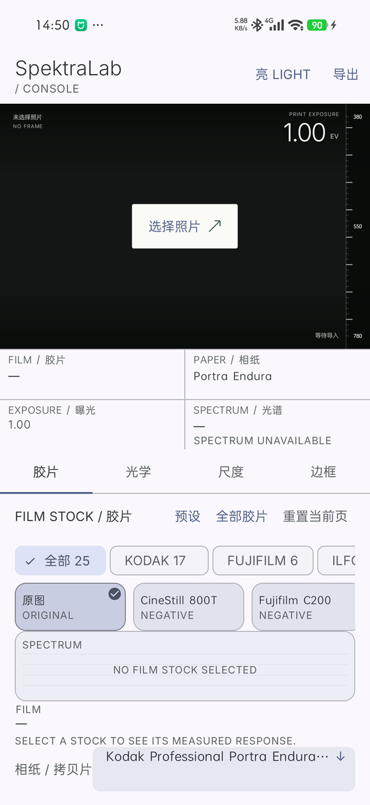
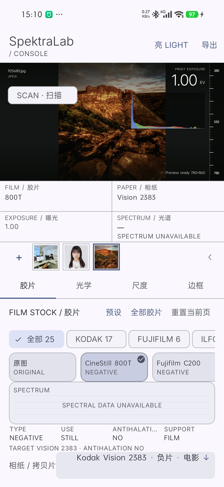
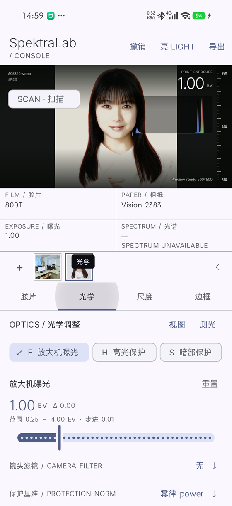
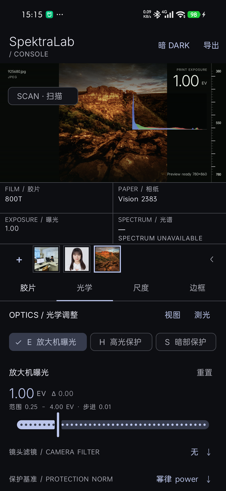

# SpektraLab for Android

[SpektraLab](https://github.com/JamesQiu2005/SpektraLab) 的胶片 / 相纸模拟引擎搬到 Android。

导入一张 RAW 或 JPEG，选好胶片和相纸，几秒内得到一张按物理过程建模的照片：光谱响应、染料层、颗粒、光晕和成色剂耦合按画幅的微米尺度计算，不是 LUT。

> 社区移植，不是上游官方版本。引擎来自上游 `assist/vulkan-engine-1.3.4`（commit `445e314`），应用层已同步到上游 `1.6.2m`。



## 界面

Material 3 控制台，同一套布局支持浅色 / 深色、动态色，手机单列、600 dp 导航 rail、720 dp 起两栏。截图来自 1200×2608 / 480 dpi 实机，Android 17。

| 胶片与实时直方图 | 光学调整 |
|---|---|
|  |  |
| **深色主题** | **空状态** |
|  |  |

- 胶片页：品牌筛选、胶片架、实测光谱曲线、相纸与目标相纸。
- 光学页：22 个参数的单滑杆 + chip 条，相机滤镜与保护基准。
- 视图页：白平衡、亮度、颜色、四区色彩分级、胶片原色、sRGB / Display P3 预览。
- 构图页：旋转、裁切、翻转，草稿应用后才写回 Look。
- 每帧独立的 Look 与撤销历史；Scan inspect 只读采样，不修改参数。
- 顶栏：撤销、主题、导出；≥600 dp 切换为导航 rail，≥720 dp 起舞台与面板并排。

## 当前版本

**稳定版：`1.4.4-m3a` · versionCode 156**

**源码预览：`1.6.2m-m3` · versionCode 385**

- [GitHub Releases](https://github.com/qwerkilo/SpektraLab-Android/releases)
- 更新通道：`update.json`（stable）与 `preview.json`（preview）
- 官网：[spektralab.workshop.skin](https://spektralab.workshop.skin/)

`1.6.2m-m3` 的主要内容：

- 同步上游 1.6.2m 的原生核心、JNI 与引擎 facade。
- 带入竖幅片边、逐帧原图、渲染纪元、导出自我校验与 RAW 缓存修复。
- 保留 M3 控制台：双主题、动态色、视图调整、构图、每帧撤销、画布缩放、Scan inspect。
- 已移植 live preview、批量导入 / 导出、命名预设、测光、色相校正、直方图、预览色域与 SP-3000 扫描预设。
- 导入不再有固定 42 MP 上限，按设备内存预算与 12000 px 长边决定；58/77 MP 仍受实机内存约束。
- 近期修复：EXIF 改用 AndroidX、直方图固定在 EV 下方、主题重建后直方图保持有数据、CI 从 release 资产安装 Gradle。

`1.4.4-m3a` 是当前稳定下载，包含 1.4.4 分带渲染、解码白平衡、加性光晕、导出元数据、RAW 修复，以及启动器图标修复。

## 现在能做什么

| 项目 | 状态 |
|---|---|
| RAW 解码（LibRaw，原生） | Panasonic GH5 `.RW2` 实测 |
| 胶片 / 相纸 | 25 款胶片 + 9 款相纸，运行时从资源目录读取 |
| 预览 | 2048 长边，约 1 秒 |
| 导出 | 长边 2048 / 3400 / 全尺寸三档；受限设备标注上限 |
| 全尺寸耗时 | 渲染约 8.2 s / 导出约 8.4 s（SM8735 + Adreno 825，20.5 MP） |
| 光学 | 曝光、高光 / 暗部保护、颗粒、光晕、眩光，共 22 个参数 |
| 画幅 | 135 / 半格 / XPan / 645 / 6×6 / 6×7 / 6×9 / 6×12 / 6×17 |
| 片边与日期后背 | Gate / Rebate / 厂标 / 帧号 / 日期文字 |
| 构图 | 旋转、裁切、翻转，预览与导出共用同一组 geometry 参数 |
| 扫描检查 | 可拖动扫描线，显示 RGB 与波长估计；不修改 Look |
| 撤销 | 每帧独立 Look 历史，M3 顶栏「撤销」 |
| 批量 | 相册 / 文件管理器多选导入；逐帧导出 JPEG / TIFF / DNG |
| 预设 | 命名保存、套用、分享 JSON、剪贴板导入 |
| 检查 | 测光方式、胶片原色、RGB 直方图、sRGB / Display P3 预览 |

## 安装

从 [Releases](https://github.com/qwerkilo/SpektraLab-Android/releases) 下载
`SpektraLab-1.6.2m-m3-arm64-v8a.apk`，安装到 arm64-v8a 的 Android 设备。

`1.6.2m-m3` 作为 preview 发布；稳定通道仍由 `update.json` 提供 156 / `1.4.4-m3a`。

Android 15 / 16（16 KB 页）请使用 release 中已 `zipalign -P 16` 的包；本地构建见下文。

## 构建

### 前置

- JDK 17（`JAVA_HOME` 指向 JDK 17 或 21）。
- Android SDK：compile / target SDK 36，build-tools 36。
- 引擎源码不在此仓库；本仓库只带 `patches/engine-android.patch`。

### Gradle（主路径）

首次克隆后，在仓库根目录创建 `local.properties`：

```properties
sdk.dir=F:\\android-sdk
```

Gradle 需要一个 **donor APK** 提供 `assets/` 和 `arm64-v8a` 原生库。默认读取：

```text
app/build/SpektraLab-1.6.2m-arm64-v8a.apk
```

也可以显式指定：

```powershell
.\gradlew.bat assembleDebug -PbaseApk="C:\path\to\SpektraLab-1.6.2m-arm64-v8a.apk"
```

`stock_catalog.json` 不从 donor 复制，而是由 `generateStockCatalog` 根据 donor 的
profiles 重新生成到 `build/generated/stockAssets`，保证 `targetPrint` 与光谱序列和资源一致。

签名：

```powershell
$env:SPK_KEYSTORE="G:\path\to\qwerkilo.jks"
$env:SPK_KS_PASS="..."
$env:SPK_KEY_PASS="..."
$env:SPK_KEY_ALIAS="qwerkilo"
```

不设置时 Gradle 使用本地 debug key；该 APK 不能覆盖已安装的 release 版本。

构建与检查：

```powershell
.\gradlew.bat checkstyleGovernance   # Alibaba-style rules
.\gradlew.bat checkJvm               # 纯 JVM 检查
.\gradlew.bat testDebugUnitTest      # JUnit 4 + Robolectric
.\gradlew.bat lintDebug              # Android lint
.\gradlew.bat assembleDebug          # 4 KB zip-aligned debug APK
.\gradlew.bat align16k               # 16 KB zip-aligned，需 build-tools 36
```

安装包：

```text
app/build/outputs/apk/debug/app-debug-16k-signed.apk
```

`align16k` 产出的 APK 已重新签名；不要安装普通的 `app-debug.apk`，它只做了 4 KB 对齐。

### CI

`.github/workflows/android.yml` 在 `windows-latest` 上运行：

1. JDK 17、Python 3.12、Android SDK 36
2. `checkstyleGovernance`、`checkJvm`、`lintDebug`、`testDebugUnitTest`
3. `check-manifest.py`、`check-apk.py`
4. 下载上游 `v1.6.2m` donor，构建并签名 16 KB APK
5. 上传可安装的 `SpektraLab-debug-16k` artifact

CI 只在 PR 和手动触发时运行；`master` 保护要求 PR 的 `build` check，合并后不再重复跑整套。
Gradle 与 donor APK 有缓存，同一 PR 的新提交会取消旧运行；需要额外验证 `master` 时用
`workflow_dispatch`。CI 使用仓库 secrets 中的 release keystore；fork PR 默认拿不到 secrets。

### 旧 Termux 路径

`app/build/build-*.sh` 与 `build-apk.sh` 仍是 pre-M3 的备用路径，假设仓库在
`$HOME/SpektraLab-apk`、引擎在 `$HOME/SpektraLab-android-adreno/engine`。新构建请优先用 Gradle。

## 验证

没有 instrumentation 测试套件。纯 JVM 检查在
`app/src/test/java/app/spektralab/*Check.java`，用 `./gradlew checkJvm` 运行；
新增 `*Check.java` 后加 `--rerun-tasks`，否则 Gradle 可能跳过。
`./gradlew testDebugUnitTest` 运行 JUnit 4 + Robolectric 的 Activity / UI wiring 测试。

`./gradlew checkstyleGovernance` 检查 `core/`、`model/`、`ui/` 与 `MainActivity` 的
命名、括号、行长、方法长度和圈复杂度。

另外三个构建门：

```powershell
python app/build/check-manifest.py
python app/build/check-apk.py app/build/outputs/apk/debug/app-debug-16k-signed.apk
python app/build/test-gen-stock-catalog.py
```

真机手动矩阵见 `docs/testing/manual-device-checklist.md`；设备操作优先用 DroidMind MCP，
不可用时再回退 `F:\android-sdk\platform-tools\adb.exe`。

## 目录

| 路径 | 内容 |
|---|---|
| `app/src/main/java/app/spektralab/` | 组合根 `MainActivity`、Look / FrameLookSession / RenderSnapshot、剩余领域接缝 |
| `app/src/main/java/app/spektralab/core/` | 无 Android 依赖的规则与格式处理（导入预算、光谱、品牌、文件名等） |
| `app/src/main/java/app/spektralab/model/` | 不可变记录：`FilmStock`、`Frame` |
| `app/src/main/java/app/spektralab/ui/` | 展示状态 `UiState`、`ThemeMode` |
| `app/src/main/java/app/spektralab/ui/widget/` | 提取出的自定义 View（光谱曲线、直方图、Scan / Compare 等） |
| `app/src/main/res/` | M3 theme、color roles、type attrs、rail menu、drawable |
| `app/src/main/cpp/` | JNI：会话、渲染、JPEG / TIFF / DNG 导出、RAW 打开 |
| `app/build/` | 资源 / 原生库 staging、Gradle 辅助脚本、Termux 旧脚本 |
| `docs/images/` | README 界面截图 |
| `patches/engine-android.patch` | 对上游引擎的 Android 适配 |
| `docs/adr/` | 架构决策 |
| `docs/specs/` | 功能规格 |
| `docs/testing/` | 设备清单与测试矩阵 |

## 已知问题

- **对比度蒙版**（`contrast_mask`）在 Vulkan 后端未移植，`capabilities.backend.unsupported_features` 显式拒绝。
- **大图上限**：没有固定像素上限；按设备内存预算（`DeviceProbe.maxPixelsByMemory`）与 12000 px 长边决定，超预算时询问按适配尺寸或原尺寸导入。
- **16 KB 原生 ELF**：APK 已做 16 KB zip 对齐；`libz_1.so` 等 donor 原生库仍是 4 KB ELF 对齐，尚未用 NDK r28 全量重建，完整 16 KB 页运行时验证仍待补。
- **大字体**：1.3× 与 2.0× 的读数表、胶片页、扫描页、构图页和 Scale 卡片已修复；仍建议逐机型复核。
- **TalkBack**：控件角色、范围、state description 已接入；尚未做完整实听验收。
- **无 instrumentation 测试**：Activity 层布局、手势、渲染导出仍以设备清单为准。
- **稳定下载**：APK 约 30.6 MB，超过 KV 的 24 MiB 限制；稳定客户端通过 `update.json` 打开 GitHub Release，官网 `/download` 可能仍指向旧资产。

## 上游与许可

- 引擎、胶片过程模型与上游实现：[JamesQiu2005/SpektraLab](https://github.com/JamesQiu2005/SpektraLab)，GPL-3.0-or-later
- 胶片模型与放大 LUT：[Andrea Volpato / spektrafilm](https://github.com/andreavolpato/spektrafilm)，CC BY-SA 4.0
- 本仓库：Android 移植（Vulkan 后端适配、JNI、M3 Console、上述修复）

代码按 **GPL-3.0-or-later** 分发（见 `LICENSE`）；胶片与相纸配置以 **CC BY-SA 4.0** 分发
（见 `LICENSE-SPEKTRAFILM.txt`）。

---

### English

An unofficial Android port of the SpektraLab film/paper simulation engine (Vulkan backend).
RAW or JPEG in, physically modelled film + paper out, on the phone.

Stable release: **1.4.4-m3a (156)**. Source preview: **1.6.2m-m3 (385)**.

The stable build carries upstream 1.4.4 banded rendering, decode white balance,
additive halation, export metadata, RAW fixes, and the M3 Console (view adjust,
composition, per-Frame undo, Scan inspect, dynamic colour, phone tabs / wide
navigation rail). The preview source tracks the upstream 1.6.2m native core:
58/77 MP rendering, a RAW decode cache, and the crash/diagnostics fixes. Live
preview, batch import/export, named presets, metering, hue correction, histogram
and the preview gamut are ported to the M3 Console; the upstream 58/77 MP
controls are the remaining M3 follow-up.

UI screenshots are in `docs/images/` and are captured on a 1200×2608 / 480 dpi
Android 17 device.

Build with `./gradlew assembleDebug` (requires JDK 17, SDK 36, and a donor
`app/build/SpektraLab-1.6.2m-arm64-v8a.apk` or `-PbaseApk=<path>`), then `./gradlew align16k`
for a 16 KB-aligned installable APK. Checks: `./gradlew checkstyleGovernance`,
`checkJvm`, `testDebugUnitTest`, `lintDebug`, `python app/build/check-manifest.py`,
`python app/build/check-apk.py <apk>`.

Known limits: no instrumentation suite; `contrast_mask` unsupported on Vulkan;
imports are bounded by device memory rather than a fixed pixel cap; 16 KB native ELF rebuild pending.
Stable downloads open the GitHub Release because the APK exceeds the 24 MiB KV limit.

Licensed GPL-3.0-or-later; film and paper profiles are CC BY-SA 4.0.
